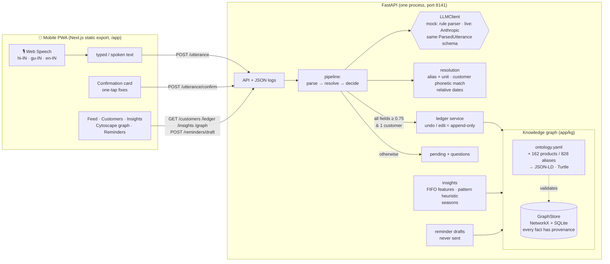

# kirana-ledger: voice-first udhaar ledger (proof of value)

Small Indian shopkeepers keep **udhaar** (customer credit) in their heads or in paper notebooks, and they think in
Hinglish, Hindi or Gujarati, not in forms. kirana-ledger lets them **say** the entry:

> *"Ramesh bhai ko 2 kilo chawal udhaar"* · *"Meena ben ne 500 diye"* · *"Kishorbhai e aadhu chukvi didhu"*

It turns that into a structured, provenance-tracked entry in a **knowledge graph**, asks instead of guessing when
it is unsure, and answers the questions a shopkeeper actually has: *who owes most, who pays late, does that change at
Diwali, and how do I remind them politely?*

> **POV, not production.** All data is synthetic. Runs fully offline in mock mode. The payment-pattern view is a labelled demo
> heuristic, **not a credit score**.

**5-minute walkthrough:** [`docs/demo-script.md`](docs/demo-script.md) · **Measured quality:** [`docs/eval-report.md`](docs/eval-report.md) · **Design:** [`PLAN.md`](PLAN.md)

## Quick start

```bash
make setup   # once: Python venv + pip, npm install (needs network once)
make demo    # fresh seeded data, builds the web app if needed → http://localhost:8141/app/
make test    # pytest (+ coverage gates) and the web smoke test
make eval    # writes docs/eval-report.md
```

There's no `make` on Windows by default; every target is also `py scripts/tasks.py <target>`.
Requirements: Python ≥ 3.12 (tested on 3.14) and Node.js LTS (tested on 24). Open the app in Chrome or Edge at phone
width. Voice uses the browser's Web Speech API (`hi-IN`, `gu-IN`, `en-IN`), and there is always a typed fallback.

## Architecture



**Graph model:** `Customer —owes→ Shop`, `Customer —bought→ Product`, `Customer —paid→ Shop`, `Alias —alias_of→ Product`,
`Customer —belongs_to_shop→ Shop`, plus `LedgerEvent —recorded_for→ Customer`, `—includes→ Product`, `—corrects→ LedgerEvent`,
and `Reminder —about→ Customer`. Every node and edge carries **provenance**: `source` (an utterance id, `seed:…` or
`correction:…`), `timestamp`, `confidence`, and `method` (rule, model or human).

| Path | What's there |
|---|---|
| `app/kg/` | `ontology.yaml` + loader and validator (JSON-LD and Turtle export via rdflib), `graph_store.py` (GraphStore protocol, NetworkX + SQLite), `provenance.py`, `llm.py` / `llm_anthropic.py` (LLMClient), `names.py` (Devanagari and Gujarati romaniser, phonetic keys, honorifics) |
| `app/core/` | `parser.py` (rule parser), `products.py` (alias and unit resolution), `customers.py` (fuzzy match and disambiguation), `dates.py`, `pipeline.py` (confirm-vs-save), `ledger.py` (balances, undo, edit), `insights.py` (features, pattern, seasons), `reminders.py` |
| `app/api/main.py` | All endpoints, request logging, static web mount |
| `web/` | Next.js 15 App Router + TypeScript + Tailwind 4 + Cytoscape.js PWA |
| `data/` | `products.yaml` (alias catalogue), `calendar.yaml` (festival and wedding windows), `generate.py` (seeded ledger) |
| `evals/` | 114 labelled + 25 untuned utterances, 65 alias hold-outs, `run_eval.py` |

**API:** `POST /utterance`, `POST /utterance/confirm`, `GET /customers`, `GET /customers/{id}`, `GET /ledger`,
`POST /ledger/{id}/undo`, `POST /ledger/{id}/edit`, `GET /insights`, `GET /graph`, `POST /reminders/draft`,
`GET /products/aliases`, `GET /health`, `GET /ontology?format=json|jsonld|turtle`. OpenAPI is at `/docs`.

## Results (from `make eval`)

| | Tuned set (114, white-box) | Untuned set (25, written after tuning) |
|---|---|---|
| Intent accuracy | 99% | 100% |
| Customer resolution | 99% | 96% |
| Item / qty+unit accuracy | 99% / 99% | 94% / 89% |
| Whole record correct | 98% | 84% |
| Disambiguation trigger rate | 100% (9/9) | 100% (2/2) |
| **False-save rate** | **0%** | **0%** after one safety fix (the first untuned run found 1: *chicken → chickpea*) |

Alias resolution: 100% of catalogue aliases, 97.6% of seeded noisy variants, 96.9% of hand-written hold-out spellings.
Coverage is about 97% on `app/` (the gate is ≥ 80% on `app/core`). The failure cases are listed in the report.

## What's mocked vs real

| Area | In this POV | Notes |
|---|---|---|
| Utterance understanding | **Real (rules)** in `LLM_MODE=mock`, the default | A deterministic parser is the "mock LLM". Tests and demo need no key. |
| LLM parsing | **Real but optional**: `LLM_MODE=live` + `ANTHROPIC_API_KEY` | `messages.parse(output_format=ParsedUtterance)` with model `ANTHROPIC_MODEL` (default `claude-opus-5-5`). It falls back to rules on any error. Not exercised by tests. |
| Speech-to-text | **Browser** Web Speech API | Accuracy and availability depend on the browser and need network (Chrome). There is no on-device Indic ASR yet. |
| Knowledge graph | **Real**: NetworkX + SQLite, ontology-validated writes, RDF export | Single shop, single process. |
| Customer and ledger data | **Synthetic**, seeded (42), 60 customers, Jun–Nov 2025 | Fixed demo clock `KIRANA_TODAY=2025-11-30` (`real` uses system date). |
| Product catalogue and prices | **Curated by hand**, approximate | 162 products, Hindi / Gujarati / Marathi transliterations. |
| Payment pattern | **Real computation, demo heuristic** | Transparent, evidence-listed, *not* a credit score, not for lending. |
| Reminders | **Drafts only** | Never sent; copy to clipboard. |
| Auth, multi-user, sync | **Not built** | See next steps. |

## Next steps to productize

1. **Offline-first sync.** On-device store (SQLite/IndexedDB) with an append-only event log that already matches the provenance model. CRDT-style merge of events (events are immutable, corrections are new events), sync over flaky 2G/3G, and a WhatsApp-style "pending" indicator.
2. **Real voice models for Indian languages.** On-device or edge ASR fine-tuned on kirana vocabulary (for example IndicConformer / Whisper variants), with code-mixed Hinglish and Gujarati. Hot-word biasing from the shop's own customer names and catalogue. Evaluate on recorded audio from consenting shopkeepers, by dialect and noise level.
3. **Lender partnership and consent model.** The shop's ledger belongs to the shop and its customers. Any sharing with an NBFC or lender would be opt-in per customer, purpose-bound and revocable, via India's Account Aggregator / DEPA consent framework. It should share summaries, not raw entries, and come with a fairness review of any derived signal. Until then the pattern stays a private, shop-only helper and is never a credit score.
4. **Catalogue and pricing.** Shop-specific price lists, barcode or SKU import, distributor catalogues, and learning new aliases from confirmed corrections (the human-confirmed provenance is already there).
5. **Collections workflow.** Scheduled reminder suggestions, UPI collect links (sent by the shopkeeper), and part-payment plans.
6. **Pricing hypothesis: ₹199–299 / month per shop.** Free tier up to about 50 customers. The value case: recovering even one forgotten ₹1,000 udhaar a month pays for it. Validate with 20–30 pilot shops across Gujarat and North India, measuring entries per day, confirmation taps per entry, and collections before and after.
7. **Hardening.** Auth and roles (owner, helper), backups, PII handling (phone numbers are deliberately absent today), observability, and multi-shop tenancy (the ontology already has `belongs_to_shop`).

## Development

- `make dev`: API with reload on :8141, serving the last web build.
- For live UI work, run `cd web && NEXT_PUBLIC_API_URL=http://localhost:8141 npm run dev` (port 3141; CORS allowed).
- `make lint` (ruff) · `make web-build` · `make web-test`.
- Logs are JSON lines on stdout with `request_id`, `method`, `path`, `status` and `ms`, plus utterance decisions.
